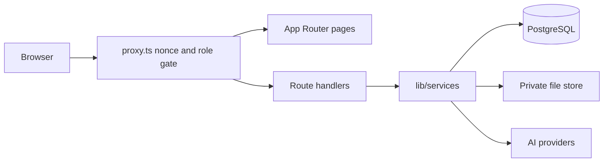

# Architecture

The app is one Next.js process. PostgreSQL holds the records. Files sit in a private directory or a private S3 bucket. AI providers are called only from the server, and only after a staff action.

## Request path

`proxy.ts` runs on document and API requests. It sets a per-request Content-Security-Policy with a script nonce and `strict-dynamic`. Style elements use that nonce. Style attributes are not allowed. Brand colours are a nonce'd class rule. The proxy also ensures the CSRF cookie exists, rejects a disabled account, and redirects the wrong role away from `/dashboard`, `/employer`, and `/candidate`.

A session is a row in `Session`. The cookie carries a random id. The database stores only its SHA-256 hash, plus hashed IP and user-agent values. `guardRequest` and `requireUser` load that row on every request. A disabled account, a revoked row, or an expired row is signed out. Changing a password, disabling the account, or "sign out everywhere" revokes every row for that person.

Route handlers call `guardRequest`, which applies the rate limit, the origin and CSRF checks, the session lookup, and `hasPermission` where the route declares a permission. Staff and admin accounts must enrol TOTP after `MFA_GRACE_DAYS`. Secrets are AES-256-GCM. Recovery codes are stored as HMAC hashes and can be used once.

Documents use the storage driver in `lib/storage/files.ts`. Development can use local disk. Production requires `STORAGE_DRIVER=s3` unless `ALLOW_LOCAL_STORAGE=true`. S3 objects are private, use random keys, and are encrypted with SSE-S3 or SSE-KMS. A download is audited, then the browser receives a link that lasts at most five minutes. The local driver still encrypts the file with `FIELD_ENCRYPTION_KEY` because a disk file has no server-side encryption header.

Pages under `app/` are the public site, the helper portal, the employer portal, and the staff desk. Shared markup is in `components/`. Copy and the white-label name live in `config/brand.ts` and `content/site.ts`.

## Domain code

| Path | Role |
| --- | --- |
| `lib/services` | Use cases: accounts, applications, employers, matching, MOM packs, reminders, outcomes, marketing, redaction |
| `lib/matching` | Deterministic score, weights, explanation facts, fairness audit, outcome suggestions |
| `lib/mom` | Eligibility, checklist, dates, public-holiday adjustments, rule review, PDF |
| `lib/email` | Console, SMTP, Resend, and SES drivers, plus signed unsubscribe tokens |
| `lib/reminders` | Reminder types, due dates, and the dry-run or send job |
| `lib/ai` | Provider list, fallback chain, budgets, prompt guard |
| `lib/security` | Passwords, CSRF, CSP, rate limit, RBAC |
| `lib/privacy` | Notice text and the retention job |
| `prisma` | Schema, migrations, fictional seed |

Staff actions that change a record go through `writeAudit`. The audit metadata helper drops keys that look like document numbers. Reminder audits store the type, status, and driver. They do not store an address or a message.

`GET /api/cron/reminders` authorises with `CRON_SECRET` and `timingSafeEqual`. It records a delivery row once per reminder, recipient, and due date. `REMINDERS_SEND` must be `true` or the row stays a dry run. A type opt-in or an approval on that reminder is required first. The email driver is selected with `EMAIL_DRIVER`.

Public holiday dates used by deadline maths come from `config/public-holidays.ts`, then from any staff adjustment, unless `MOM_PUBLIC_HOLIDAYS` replaces the list. MOM catalog overrides live in `MomRuleState` and are applied by `effectiveMomRules()` when a pack is built.

## AI boundary

Ranking is code. A model may write an explanation from the numeric breakdown, or a marketing draft from public profile facts. The prompt wrapper marks free text as untrusted, rejects sensitive keys, and uses a schema with no tools. If every configured provider fails, the feature returns a labelled template. Usage rows store provider, model, token counts, and an estimated cost. They do not store the prompt.

## What is intentionally absent

- Singpass and CorpPass login, and any submission to MOM
- Posting an approved draft to a social network
- A hosted identity provider. The cookie format is documented so one can be added
- A worker process. Cron is an HTTP call with `CRON_SECRET`
