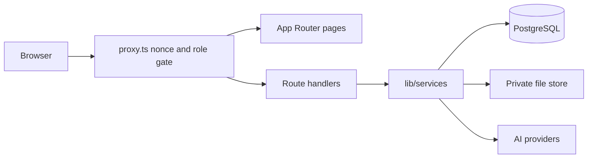

# Architecture

The app is one Next.js process. PostgreSQL holds the records. Files sit in a private directory or a private S3 bucket. AI providers are called only from the server, and only after a staff action.

## Request path

`proxy.ts` runs on document and API requests. It sets a per-request Content-Security-Policy with a script nonce, ensures the CSRF cookie exists, and redirects the wrong role away from `/dashboard`, `/employer`, and `/candidate`. Route handlers call `guardRequest`, which applies the rate limit, the origin and CSRF checks, and `hasPermission` where the route declares a permission.

Pages under `app/` are the public site, the helper portal, the employer portal, and the staff desk. Shared markup is in `components/`. Copy and the white-label name live in `config/brand.ts` and `content/site.ts`.

## Domain code

| Path | Role |
| --- | --- |
| `lib/services` | Use cases: accounts, applications, employers, matching, MOM packs, marketing, redaction |
| `lib/matching` | Deterministic score, weights, explanation facts, fairness audit |
| `lib/mom` | Eligibility, checklist, dates, PDF |
| `lib/ai` | Provider list, fallback chain, budgets, prompt guard |
| `lib/security` | Passwords, CSRF, CSP, rate limit, RBAC |
| `lib/privacy` | Notice text and the retention job |
| `prisma` | Schema, migrations, fictional seed |

Staff actions that change a record go through `writeAudit`. The audit metadata helper drops keys that look like document numbers.

## AI boundary

Ranking is code. A model may write an explanation from the numeric breakdown, or a marketing draft from public profile facts. The prompt wrapper marks free text as untrusted, rejects sensitive keys, and uses a schema with no tools. If every configured provider fails, the feature returns a labelled template. Usage rows store provider, model, token counts, and an estimated cost. They do not store the prompt.

## What is intentionally absent

- Singpass and CorpPass login, and any submission to MOM
- Posting an approved draft to a social network
- A hosted identity provider. The cookie format is documented so one can be added
- A worker process. Cron is an HTTP call with `CRON_SECRET`
